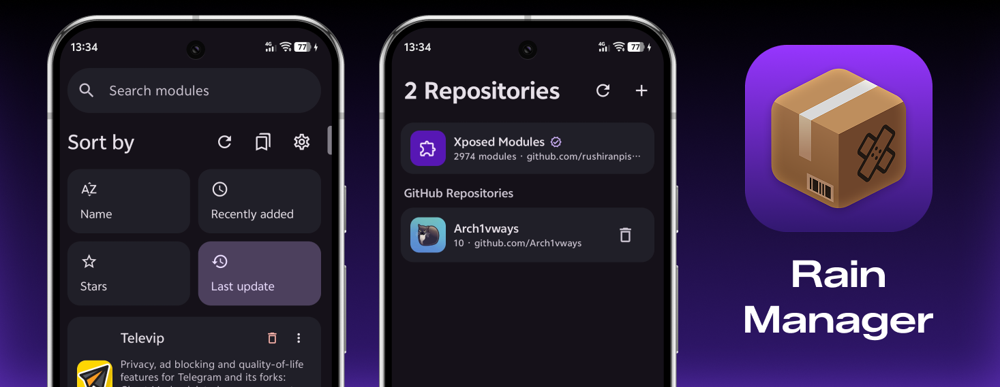

# Rain Manager

A universal repository and Lsposed module android manager.  
Forked from [rushiranpise/lsposed-modules-manager](https://github.com/rushiranpise/lsposed-modules-manager).

- Package: `arch1.dev.rainmanager`
- Minimum Android: 8.1 (API 26)
- Latest release: [Releases](https://github.com/Arch1vways/Rain-Manager/releases)

## Features

- Browse, search, and sort modules by name, recently added, stars, or last update.
- Add GitHub author/organization repositories directly or via deep links (`rainmanager://github.com/<author>`).
- Install, update, or uninstall modules using System, Session, Shizuku, or Root installers.
- Auto-translate module descriptions, READMEs, and release notes.
- Material You dynamic colors, purple default theme, AMOLED black mode, and selectable app icons.
- English and Russian UI localization.

## How to Build

### Prerequisites

- **JDK 17** or newer
- **Android SDK** (Platform 36 / 37 and Build-Tools 36.0.0)
- Set `ANDROID_HOME` to your Android SDK directory

### Build Steps

1. Clone the repository:
   ```bash
   git clone https://github.com/Arch1vways/Rain-Manager.git
   cd Rain-Manager
   ```

2. Build the release APK:

   **Windows (PowerShell):**
   ```powershell
   $env:ANDROID_HOME = "C:\android-sdk"
   .\gradlew.bat assembleRelease
   ```

   **Linux / macOS:**
   ```bash
   export ANDROID_HOME="$HOME/Android/Sdk"
   ./gradlew assembleRelease
   ```

3. Sign the APK (if signing environment variables were not set):
   ```powershell
   apksigner sign --ks ~/.android/debug.keystore --ks-pass pass:android --key-pass pass:android --out app/build/outputs/apk/release/app-release.apk app/build/outputs/apk/release/app-release-unsigned.apk
   ```

   Or pass your release keystore via environment variables before running Gradle:
   - `KEYSTORE_PATH`
   - `KEYSTORE_PASSWORD`
   - `KEY_ALIAS`
   - `KEY_PASSWORD`

4. The built APK will be located at `app/build/outputs/apk/release/app-release.apk`.

## License

Licensed under the [MIT License](LICENSE).
